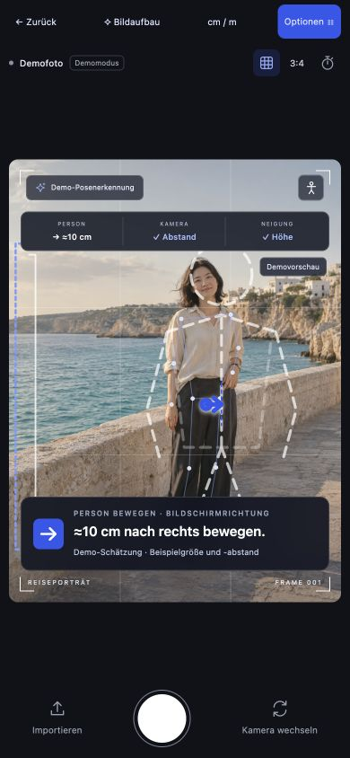
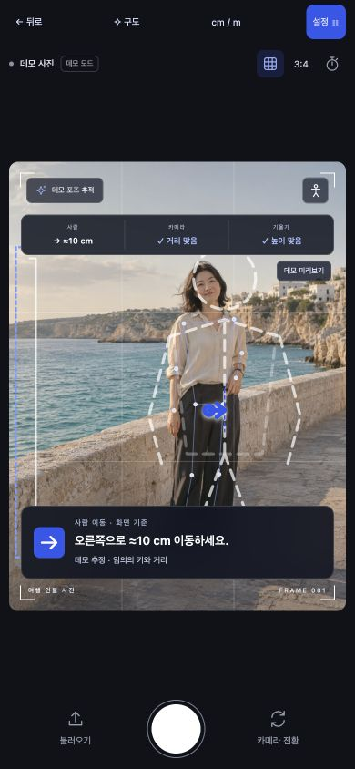

# FRAME — Kamera-Coach

**[Deutsch](README.md) · [English](README.en.md) · [한국어](README.ko.md)**

FRAME hilft einer Person, Position, Bildausschnitt und Pose beim Fotografieren anzupassen. Die Analyse läuft auf dem Gerät. Die Oberfläche und die Sprachanleitung unterstützen **Deutsch, Englisch und Koreanisch**.

- [Web-App](https://oyoungsoo97-hub.github.io/frame-camera/)
- [Native Builds und Downloads](https://github.com/oyoungsoo97-hub/frame-camera/actions/workflows/native.yml)
- [Vollständige Bau- und Release-Anleitung](docs/BUILD-AND-RELEASE.md)

> Version 2.0.0 / Beta. Web, iOS und Android teilen dieselbe Kameralogik. iOS und Android sind echte native Capacitor-Projekte mit lokal gebündelter Web-Oberfläche. Es wird keine entfernte Website in der App geladen. Ein iOS-Simulator-Build ist keine auf einem iPhone installierbare IPA; für das iPhone ist Apple-Signierung erforderlich.

## Vorschau

| Deutsch | 한국어 |
|---|---|
|  |  |

Die Bilder zeigen die Demo mit hypothetischer Kalibrierung.

## Was enthalten ist

| Format | Projekt / Ausgabe | Verwendung |
|---|---|---|
| HTML / PWA | `dist/index.html` mit allen lokalen Ressourcen | Statisches HTTPS-Hosting, iPhone Safari, Android Chrome |
| Apple iOS | `ios/App/App.xcodeproj` | Xcode-Projekt, iOS 15+, Signierung im eigenen Apple-Team |
| iOS-Simulator | GitHub-Actions-Artefakt `FRAME-iOS-Simulator` | `.app.zip` für Xcode Simulator, nicht für ein echtes iPhone |
| Android | `android/` | Android-Studio-/Gradle-Projekt, Android 7 / API 24+ |
| Android-Testdatei | GitHub-Actions-Artefakt `FRAME-Android-debug` | Debug-APK nach erfolgreichem Build |

Der erfolgreiche Status eines Builds ist in GitHub Actions sichtbar. Eine vorhandene Workflow-Datei allein belegt keinen erfolgreichen Build. Store-Veröffentlichungen, ein signiertes iOS-IPA und ein signiertes Android-Release-AAB sind nicht automatisch eingerichtet.

## Funktionen

- Vollbildkamera mit Auslöser, Bildaufbau-Hilfe und Optionsblatt.
- Zielkontur, erkannte Gelenke und Richtungspfeile direkt im Kamerabild.
- Kalibrierte **cm/m-Schätzwerte** für seitliche Bewegungen und Kameraabstand.
- Reise, Café, Ganzkörper und Sitzend: sieben Posen mit Hand- und Blicktipps.
- Bildaufbau-Vorschläge anhand von Helligkeit, Hintergrundkanten und möglichem Horizont.
- **Beste aus 3**: drei Fotos speichern und einen Kandidaten nach Augenstatus, Schärfe und Bildänderung markieren.
- Automatische Aufnahme nach zwei Sekunden passender Ausrichtung; mit „Beste aus 3“ zusätzlich frische Augen- und Stabilitätsprüfung.
- Vorder-/Rückkamera, Raster, 3:4-/1:1-Ausschnitt, 3-/5-Sekunden-Timer, Fotoimport.
- Lokale Galerie und Export. Native Apps verwenden den Teilen-Dialog des Betriebssystems.
- Automatische Sprachwahl nach Gerätesprache, manuelle Auswahl und gespeicherte Präferenz.

## Schnell ausprobieren

1. Öffne die [Web-App](https://oyoungsoo97-hub.github.io/frame-camera/) in Safari oder Chrome.
2. Wähle oben **Deutsch**, **English** oder **한국어**. In der Vollbildkamera liegt die Auswahl unter **Optionen**.
3. Tippe **Kamera starten** und erlaube die Kamera. **Demo ansehen** funktioniert ohne Kamerazugriff.
4. Wähle Situation und Pose, folge der Kontur und dem Pfeil.
5. Unter **cm / m einrichten** gibst du Körpergröße und aktuellen Kameraabstand ein. Kalibriere aufrecht, mit Kopf und beiden Füßen im Bild.
6. Fotografiere; die Galerie zeigt alle Kandidaten. Exportiere wichtige Fotos.

Im Web: Safari → Teilen → Zum Home-Bildschirm. Für die native iOS-App: Projekt in Xcode öffnen, eigenes Team auswählen und auf dem gekoppelten iPhone starten.

## Lokal entwickeln

Benötigt: Node.js 22+, npm; Python 3 nur für den einfachen lokalen Webserver.

```sh
npm ci
npm run build
npm test
npm run check
npm start
```

`npm start` startet den lokalen Server. Öffne nicht einfach `index.html` als Datei: JavaScript-Module, Modelle und Kamera benötigen einen Server. Kamera im Web erfordert HTTPS; `localhost` ist die Entwicklungs-Ausnahme.

### iOS

```sh
npm run build
npx cap sync ios
npm run ios
```

Xcode 26+ und macOS sind erforderlich. Unter **Signing & Capabilities** dein Team auswählen. Die Projektkennung lautet `io.github.oyoungsoo97hub.framecamera`; passe sie bei Bedarf in der Capacitor-Konfiguration und beiden nativen Projekten an. Kamera-Berechtigungstexte sind in allen drei Sprachen hinterlegt.

### Android

```sh
npm run build
npx cap sync android
npm run android
# Alternativ mit installiertem JDK 21 und Android SDK:
cd android
./gradlew assembleDebug
```

Ausgabe: `android/app/build/outputs/apk/debug/app-debug.apk`. Eine Release-Signierung mit dauerhaftem Keystore wird separat eingerichtet. Keine Schlüssel oder Zugangsdaten ins Repository hochladen.

## Grenzen und Genauigkeit

Die App unterstützt eine Person. cm/m sind Schätzungen aus deiner Kalibrierung und Bildgeometrie — keine LiDAR-/ARKit-Messungen. Person, Haltung, Kamera und Zoom müssen gleich bleiben. Sitzposen verwenden visuelle Hinweise ohne stehende Maßstabs-Kalibrierung.

Blicktipps sind Anweisungen; Blickrichtung wird nicht gemessen. Eine vermeintliche Horizontlinie kann eine Mauer sein. Augenstatus und Schärfe sind unsichere Messgrößen. Der Vorschlag bewertet weder Schönheit noch Identität. Das Web-Kamerabild ersetzt keine native ProRAW-/HDR-Foto-Pipeline.

Ein erfolgreicher Build belegt die Kompilierung, nicht die Kamerafunktion auf realer Hardware. Vor einer Store-Veröffentlichung sind Tests auf echten iPhones und Android-Geräten nötig.

## Dokumentation

- [Bedienung auf Deutsch](docs/USER-GUIDE.de.md)
- [Architecture and algorithms](docs/ARCHITECTURE.md)
- [Build, signing and deployment](docs/BUILD-AND-RELEASE.md)
- [Privacy and storage](docs/PRIVACY.md)
- [Languages and translation workflow](docs/LOCALIZATION.md)
- [Tests and device checklist](docs/TESTING.md)
- [Troubleshooting](docs/TROUBLESHOOTING.md)
- [Third-party notices](THIRD_PARTY_NOTICES.md)
- [Changelog](CHANGELOG.md)

Projektcode erhält durch die Veröffentlichung keine zusätzliche Open-Source-Lizenz. Drittanbieter-Bibliotheken und Modelle behalten ihre jeweiligen Lizenzen. Das Demofoto ist KI-generiert und kein hochgeladenes Nutzerfoto.
